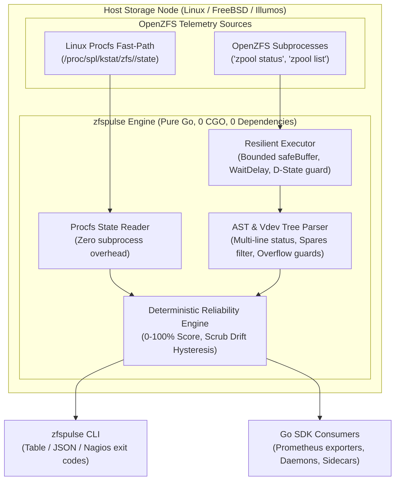

# zfspulse

[](https://go.dev/)
[-brightgreen)](#zero-cgo-architecture)
[-success)](#zero-cgo-architecture)
[](https://eur-lex.europa.eu/eli/dir/2022/2555/oj)
[](LICENSE)

**zfspulse** is a high-performance, safe-by-design OpenZFS storage reliability monitor and telemetry inspector engineered in pure Go with **zero external dependencies** (`CGO_ENABLED=0`).

Designed to satisfy the stringent requirements of EU Directive 2022/2555 (**NIS2 Article 21**: Cybersecurity Risk Management) and the **Digital Operational Resilience Act (DORA)**, `zfspulse` provides deterministic reliability scoring (0–100%), kernel D-state hang isolation, and zero-allocation fast paths for enterprise storage environments (JBOD, SAN, multi-tier pools).

---

## Why zfspulse?

Most OpenZFS monitoring setups rely on naive cron scripts (`zpool status -x | mail`), brittle shell one-liners, or generic exporters that execute commands without subprocess safeguards. When storage is nominal, everything appears fine. But **when hardware actually fails**, traditional monitoring often becomes the first casualty.

### The Problem in HomeLab & Self-Hosted Storage
- **Silent Degradation & Scrub Neglect:** Disks rarely fail all at once. Checksum errors slowly creep in, or automated scrubs quietly lapse due to misconfigured crontabs. Binary checks that only verify if a pool is `ONLINE` provide a false sense of security while unrecoverable bitrot accumulates.
- **Agent Bloat:** Running resource-heavy monitoring daemons, Python runtimes, or JVM stacks on low-power home servers (Intel N100, Raspberry Pi, TrueNAS, Proxmox VE) consumes memory and CPU that belongs to your workloads.
- **The `zfspulse` Advantage:** A single static binary with a tiny memory footprint (<18 MB RSS) that computes a holistic, deterministic **Reliability Score (0–100%)**, detects scrub lapses, and integrates natively into both CLI terminals and local dashboards.

### The Problem in Enterprise, SAN & High-Density JBOD
- **The Kernel D-State Trap:** When a SAS controller, HBA, or NVMe backplane wedges, standard CLI commands (`zpool status`) enter Linux uninterruptible sleep (`D-state`). Naive cron jobs or daemon scrapers hang indefinitely, accumulating zombie processes, exhausting OS process table limits (PIDs), and blinding the monitoring infrastructure during a live storage emergency.
- **Diagnostic Floods & Memory Exhaustion:** On high-density enclosures (60–102 drive JBODs with multi-tier vdev topologies), cascading drive drops generate multi-megabyte diagnostic dumps. Unbounded shell pipes and naive parsers trigger Out-Of-Memory (OOM) panics.
- **Strict Compliance & Supply-Chain Hygiene (NIS2, DORA):** Modern storage nodes residing in isolated management VLANs require verifiable supply-chain security, zero dynamically linked C libraries, and unprivileged execution.
- **The `zfspulse` Advantage:** Subprocess execution bounded by `WaitDelay` to isolate kernel D-state deadlocks within ~5 seconds (elevating to `FAULTED`), strict 1 MB `safeBuffer` memory ceilings, and **zero external dependencies** (`stdlib-only`, `CGO_ENABLED=0`).

### Feature Comparison: `zfspulse` vs. Alternatives

| Operational Capability | Naive Bash / Python Scripts | Generic Prometheus Exporters | `zfspulse` |
|---|:---:|:---:|:---:|
| **Kernel D-State Hang Isolation** | ❌ Hangs forever, leaks zombie processes | ❌ Freezes scrape loops or leaks goroutines | ✅ **Isolated via `WaitDelay` in ~5s (Fail-Closed `FAULTED`)** |
| **Diagnostic Buffer Bounding** | ❌ Unbounded pipes, OOM risk on JBODs | ⚠️ Memory spikes under large diagnostic outputs | ✅ **Hard 1 MB `safeBuffer` ceiling with truncation guard** |
| **Holistic Health Quantification** | ❌ Binary string match (`ONLINE`/`DEGRADED`) | ⚠️ Raw device gauges without synthesized rating | ✅ **Deterministic Reliability Score (0–100%)** |
| **Active Scrub Hysteresis** | ❌ False alarms during active scrubs | ⚠️ Confusing timestamps or false alerts | ✅ **Freezes scrub drift penalties during active scans** |
| **Zero Supply-Chain Vulnerabilities** | ❌ Fragile shell/pip/interpreter environments | ⚠️ Multiple transitive dependencies | ✅ **Zero 3rd-party dependencies (`stdlib-only`), pure Go** |
| **Flexible Integration Modes** | ❌ Fragile string scraping | ⚠️ HTTP metrics exposition only | ✅ **Tri-mode: Formatted Table, Exit codes 0-3, Prometheus `/metrics`** |

---

## Architectural Highlights



### 1. Zero CGO & Supply-Chain Hygiene
- **Zero 3rd-Party Dependencies:** Built exclusively on the Go standard library. Eliminates supply-chain risks, transitively imported vulnerabilities, and package bloat.
- **Pure Go (`CGO_ENABLED=0`):** Compiles cleanly to tiny static binaries without dynamically linked C libraries, making it trivially portable across Linux, FreeBSD, and macOS.

### 2. Kernel D-State Hang Isolation
- **Bounded `safeBuffer`:** Prevents out-of-memory crashes during high-volume diagnostic dumps on 100+ disk JBOD arrays with a strict 1 MB memory cap and truncation signaling.
- **Non-blocking Contexts & `WaitDelay`:** If an underlying disk controller locks up and puts the `zpool` CLI into kernel uninterruptible sleep (D-state), `zfspulse` aborts cleanly without leaking goroutines or process descriptors.
- **Fail-Closed Elevation:** Genuine kernel D-state deadlocks (`SuspectedKernelHang`) elevate the pool state to `FAULTED` and increment `zfs_hung_commands_total`. Leaked descriptors elevate to `DEGRADED`, and software timeouts elevate to `UNKNOWN` to ensure unverified state is never masked as healthy.

### 3. Deterministic Reliability Scoring (0–100%)
- **Baseline State Valuation:** `ONLINE` pools start at 100.0%, `DEGRADED` at 40.0%, and `FAULTED` / `UNAVAIL` / `OFFLINE` / `REMOVED` / `SUSPENDED` / `UNKNOWN` score strictly 0.0%.
- **Fail-Closed State Verification:** Unverified or missing CLI results safely downgrade an unconfirmed `ONLINE` state to `UNKNOWN`. Missing CLI binaries immediately trigger `UNAVAIL`.
- **Scrub Drift Penalty:** Penalizes pools whose scrub age exceeds the configured threshold (default 30 days) to prevent silent bitrot accumulation. Active scrubs freeze drift penalties to avoid false alerts.
- **Saturating Counter Arithmetic:** Safely tallies read, write, and checksum errors across vdev hierarchies using non-wrapping saturating 64-bit integer addition.
- **Spares Exclusion:** Inactive hot spares do not penalize healthy active vdev pools.

---

## CLI Installation & Usage

### Pre-built Binaries
Download the latest static binary for your platform from the GitHub Releases page.

### Build from Source
```bash
git clone https://github.com/AlexNortonFenn/zfspulse.git
cd zfspulse
CGO_ENABLED=0 go build -o zfspulse ./cmd/zfspulse
```

### Commands & Options

#### 1. Pool Status Table (`status`)
Inspects all discovered pools or specific target pools:
```bash
# Discover and inspect all pools on host
zfspulse status

# Inspect specific target pools
zfspulse status rpool tank
```

Output:
```text
POOL   STATE    SCORE   READ   WRITE   CKSUM   SCRUB DRIFT   STATUS
rpool  ONLINE   100.0%  0      0       0       2.1d          nominal
tank   ONLINE   95.0%   0      0       0       34.5d         nominal
```

**Options:**
- `--json`: Output full telemetry as structured JSON.
- `--timeout <seconds>`: Subprocess execution timeout (default `15`).
- `--proc-path <path>`: Custom Linux procfs path (default `/proc/spl/kstat/zfs`).

```bash
zfspulse status --json tank
```
```json
[
  {
    "name": "tank",
    "state": "ONLINE",
    "read_errors": 0,
    "write_errors": 0,
    "checksum_errors": 0,
    "scrub_drift_hours": 828.0,
    "reliability_score": 95.0,
    "status_note": "nominal"
  }
]
```

#### 2. Monitoring Check (`check`)
Evaluates storage reliability against warning and critical thresholds, returning standard monitoring exit codes for Nagios, Icinga, Zabbix, or cron jobs:
- **0 (OK):** All pools are healthy with reliability score $\ge 75\%$.
- **1 (WARNING):** Pool reliability score $< 75\%$ or scrub drift threshold exceeded.
- **2 (CRITICAL):** Pool is `DEGRADED`, `FAULTED`, `UNAVAIL`, `OFFLINE`, `SUSPENDED`, or score $< 50\%$.
- **3 (UNKNOWN):** Command timeout, kernel deadlock, unverified state, or missing `zpool` binary.

```bash
# Check all pools with default thresholds
zfspulse check

# Check specific pool with custom thresholds
zfspulse check -warn 80.0 -crit 60.0 tank

# Output JSON summary with exit code
zfspulse check --json tank
```

**Options:**
- `-warn <score>`: Warning threshold percentage (default `75.0`).
- `-crit <score>`: Critical threshold percentage (default `50.0`).
- `--json`: Output check results in JSON format.
- `--timeout <seconds>`: Execution timeout in seconds (default `15`).
- `--proc-path <path>`: Custom Linux procfs path.

#### 3. Telemetry Server (`serve`)
Spins up an embedded HTTP telemetry engine providing OpenMetrics / Prometheus scrape endpoints and health probes:
```bash
zfspulse serve --listen 127.0.0.1:9100 --timeout 15 --scrub-drift-hours 720
```

**Endpoints:**
- `/metrics`: OpenMetrics / Prometheus exposition with one-hot pool states, device error counters, scrub drift, and hang counters.
- `/healthz`: Process liveness probe for orchestrators.
- `/readyz`: Storage readiness probe returning HTTP 503 on `CRITICAL` storage states (`FAULTED`, `UNAVAIL`, `SUSPENDED`, etc.).

**Options:**
- `--listen <addr:port>`: Address and port to bind metric server (default `127.0.0.1:9100`).
- `--timeout <seconds>`: Subprocess execution timeout in seconds (default `15`).
- `--scrub-drift-hours <hours>`: Hours before scrub drift penalty applies (default `720.0` / 30 days).
- `--proc-path <path>`: Custom Linux procfs path.

#### 4. Version Information (`version`)
Displays build version, commit hash, build date, and Go compiler version:
```bash
zfspulse version
```

---

## Go SDK Usage

Import `github.com/AlexNortonFenn/zfspulse` directly into your Go applications:

```go
package main

import (
	"context"
	"fmt"
	"log"
	"time"

	"github.com/AlexNortonFenn/zfspulse"
)

func main() {
	ctx := context.Background()

	// Initialize Inspector with functional options
	inspector := zfspulse.New(
		zfspulse.WithProcZfsPath("/proc/spl/kstat/zfs"),
		zfspulse.WithScrubDriftThresholdHours(720.0), // 30 days
		zfspulse.WithCommandTimeout(10*time.Second),
	)

	// Inspect a specific pool
	health, err := inspector.InspectPool(ctx, "tank")
	if err != nil {
		log.Printf("Inspection note: %v", err)
	}

	fmt.Printf("Pool: %s\n", health.Name)
	fmt.Printf("State: %s (Severity: %s)\n", health.State, health.Severity())
	fmt.Printf("Reliability Score: %.1f%%\n", health.ReliabilityScore)
	fmt.Printf("Errors: Read=%d, Write=%d, Checksum=%d\n",
		health.ReadErrors, health.WriteErrors, health.ChecksumErrors)

	// Discover and inspect all pools on host
	allPools, err := inspector.InspectAll(ctx)
	if err != nil {
		log.Fatalf("Failed to inspect all pools: %v", err)
	}
	for _, p := range allPools {
		fmt.Printf("Found pool %s: Score=%.1f%%\n", p.Name, p.ReliabilityScore)
	}
}
```

---

## Compliance Reference

| Regulatory Mandate | Technical Requirement | `zfspulse` Implementation |
|---|---|---|
| **NIS2 Article 21(2)(c)** | Business continuity and crisis management | Fail-closed telemetry; unverified pools score 0.0% (`UNKNOWN`) |
| **NIS2 Article 21(2)(d)** | Supply-chain security of network and information systems | **Zero 3rd-party dependencies**, stdlib-only attack surface |
| **DORA Article 9(1)** | Protection and prevention of ICT operational disruptions | Kernel D-state hang isolation via bounded `safeBuffer` and `WaitDelay` |
| **DORA Article 10(2)** | Continuous identification of ICT system degradation | Sub-minute scrub drift monitoring and saturating vdev error calculation |

---

## Known Limitations & Laboratory Edge Cases

- **Synthetic Mock Flood on `DiscoverPools`:** Under synthetic laboratory test conditions where a mocked or malfunctioning `zpool` executable outputs tens of thousands of non-pool lines into `zpool list -H -o name` (e.g. raw disk paths), auto-discovery attempts to query each entry, resulting in elevated CPU usage and subprocess storms. Standard OpenZFS environments returning valid pool names are unaffected. Explicit pool name regex filtering (`^[a-zA-Z][a-zA-Z0-9_.:-]*$`) and an auto-discovery limit cap are scheduled for release v0.1.1.

---

## Support & Donations

If you find `zfspulse` valuable for keeping your storage infrastructure resilient and want to support ongoing development:

- **Ethereum (ETH / ERC-20):** `0xBd85A47509D50A5488B58985C9Af8C043eE1E186`

---

## License

Distributed under the [MIT License](LICENSE).  
Copyright (c) 2026 Alex Norton Fenn.
